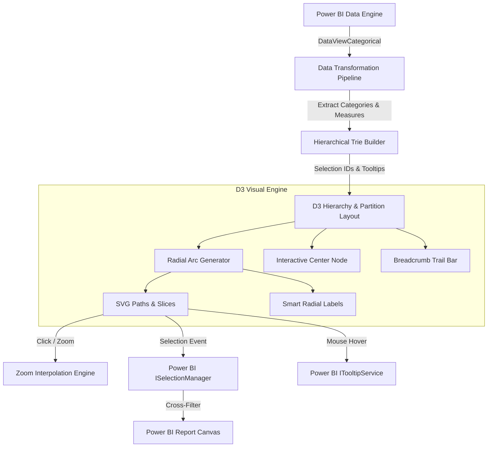

# Interactive D3 Sunburst Visual for Microsoft Power BI

[](https://learn.microsoft.com/en-us/power-bi/developer/visuals/)
[](https://d3js.org/)
[](https://www.typescriptlang.org/)
[](LICENSE)
[](#contributing)

A high-performance, enterprise-grade **Custom Visual for Microsoft Power BI** engineered with **D3.js v7** and **TypeScript**. It transforms complex, multi-level hierarchical categorical data into an interactive radial partition (sunburst) chart with smooth animated transitions, breadcrumb trail navigation, cross-filtering, and native Power BI formatting pane controls.

---

## 🌟 Key Features

- **Multi-Level Drill-Down**: Supports arbitrary depth hierarchies (e.g. *Division &rarr; Region &rarr; Product Line &rarr; SKU*).
- **Smooth Radial Transitions**: Seamless animated drill-down zooming on slice clicks and drill-up navigation via center circle or breadcrumbs.
- **Interactive Breadcrumb Navigation**: Real-time breadcrumb trail displaying the current navigation path with click-to-ancestor navigation.
- **Power BI Selection & Cross-Filtering**: Integrated with Power BI's `ISelectionManager`—clicking any segment cross-filters and highlights other visuals on the report page (supports multi-select with <kbd>Ctrl</kbd>/<kbd>Cmd</kbd> + click).
- **Native Tooltips & Context Menu**: Rich Power BI tooltips displaying hierarchy path, value, and share-of-total, plus native right-click context menu support.
- **Modern Formatting Pane**: Configurable via the Modern Power BI Formatting Model:
  - **Chart Configuration**: Inner hole ratio, corner radius, pad angle, animation duration, and color palettes (*Tableau 10*, *D3 Category 10*, *Paired*, *Spectral*, *Accent*).
  - **Data Labels**: Toggle labels, font size, font color, and angle-based smart truncation.
  - **Breadcrumbs**: Show/hide, font styling.
  - **Center Summary**: Dynamic center total and custom metric label.
- **Graceful Empty State**: Native landing page prompting report authors with required data roles when no data is bound.
- **Standalone Web Demo**: Includes a pure HTML/JS live interactive preview in `/demo` for instant browser testing without requiring Power BI.

---

## 🏗️ Architecture & Data Flow



---

## 🚀 Quick Start for End Users (Power BI Desktop)

1. **Download the Visual**:
   - Download the latest `.pbiviz` package from [Releases](https://github.com/DonytXz/powerbi-sunburst-d3/releases) or the `dist/` folder:
     ```
     dist/sunburstD3Visual4F7BE92993D24F5CB77C828463B9033A.1.0.0.0.pbiviz
     ```
2. **Import into Power BI Desktop**:
   - In Power BI Desktop, open the **Visualizations** pane.
   - Click the ellipsis (`...`) &rarr; **Import a visual from a file**.
   - Select the `.pbiviz` file.
3. **Map Your Fields**:
   - **Hierarchy Levels** (Grouping): Drag 1 to 5 categorical columns (e.g., `Division`, `Region`, `Product Line`).
   - **Value** (Measure): Drag a numeric measure (e.g., `Revenue`, `Sales`, `Count`).
   - **Tooltips** (Optional): Add any additional measures to display on hover.

> 💡 **Sample Dataset**: A ready-to-import test dataset is provided at [`sample-data/sales_hierarchy_sample.csv`](sample-data/sales_hierarchy_sample.csv).

---

## 💻 Developer Setup & Local Debugging

### Prerequisites
- [Node.js](https://nodejs.org/) (v18, v20, or v22 recommended)
- [Power BI Desktop](https://powerbi.microsoft.com/desktop/) or Power BI Service (with Developer Visual enabled)

### 1. Clone & Install
```bash
git clone https://github.com/DonytXz/powerbi-sunburst-d3.git
cd powerbi-sunburst-d3
npm install
```

### 2. Install Power BI Visuals CLI
```bash
npm install -g powerbi-visuals-tools
```

### 3. Run Development Server
```bash
npm start
# or
pbiviz start
```
This spins up a secure local HTTPS server on port `8080`.

### 4. Connect to Power BI
1. In Power BI Service (app.powerbi.com) or Power BI Desktop with developer mode enabled.
2. Select the **Developer Visual** icon in the Visualizations pane.
3. The visual will hot-reload automatically as you edit files in `src/`.

### 5. Production Packaging
```bash
npm run package
```
Generates the verified, certified `.pbiviz` file in the `dist/` directory.

---

## 🌐 Standalone Live Browser Demo

To test the visual in your web browser without Power BI:
1. Open [`demo/index.html`](demo/index.html) directly in any modern browser, or run a local web server:
   ```bash
   npx serve demo
   ```
2. Switch datasets, experiment with the inner hole ratio, corner radius, pad angle, and color palettes, and test drill-down animations.

---

## 📂 Project Structure

```text
├── .github/workflows/          # CI/CD GitHub Actions for build & release
├── assets/                     # Visual icon and assets
├── demo/                       # Standalone live interactive web demonstration
│   ├── index.html              # Demo HTML dashboard
│   ├── demo.css                # Demo styling
│   └── demo.js                 # D3.js interactive demo engine & datasets
├── sample-data/                # Sample CSV datasets for testing in Power BI
│   └── sales_hierarchy_sample.csv
├── src/                        # TypeScript source code
│   ├── settings.ts             # Modern Power BI formatting model cards
│   ├── transform.ts            # Data transformation (Categorical -> Hierarchy Tree)
│   ├── types.ts                # TypeScript interfaces and type definitions
│   └── visual.ts               # Core IVisual implementation & D3 rendering engine
├── style/
│   └── visual.less             # Visual styles (breadcrumbs, slices, landing page)
├── capabilities.json           # Power BI capabilities & data roles schema
├── pbiviz.json                 # Visual metadata & plugin configuration
├── tsconfig.json               # TypeScript compiler configuration
└── package.json                # Project dependencies & build scripts
```

---

## 🛡️ License

This project is open-source under the [MIT License](LICENSE).
